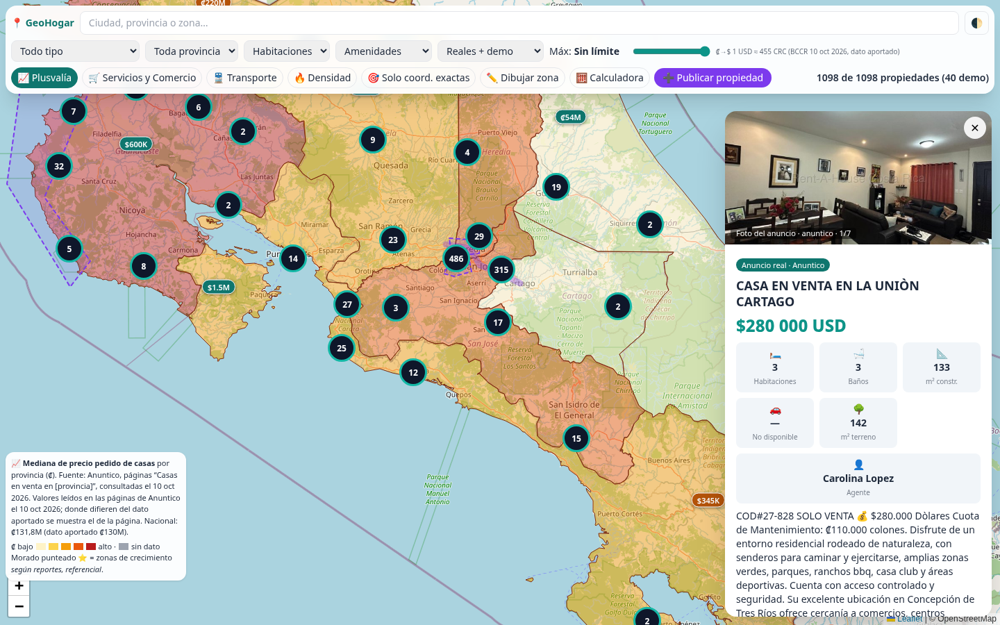

# GeoHogar

Aplicación web de bienes raíces en Costa Rica con navegación 100% centrada en el mapa (Leaflet + Tailwind + JavaScript puro, en un solo `index.html`).

- Demo: https://pcalifax-byte.github.io/geohogar/
- Datos: anuncios públicos de Anuntico y Encuentra24 (captura del 10 oct 2026) y 40 propiedades de demostración marcadas como [DEMO].
- Tipo de cambio aproximado: 1 USD = ₡455.
- Base de datos: `schema.sql` (PostgreSQL + PostGIS) y `schema.json`.
- Backend y escalado: ver `BACKEND.md`.

## Datos y actualización
Los datos viven en `data/` y se actualizan con `python3 scripts/update.py` (commit + push solo si hay cambios). Ver `BACKEND.md` §9–10.
